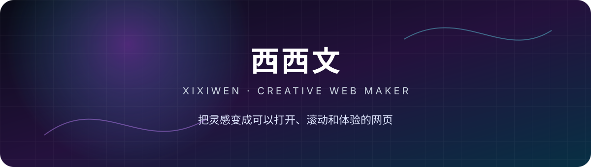

  

  <a href="https://github.com/xxwxixiwen?tab=repositories">◼ 作品</a>
  &nbsp;·&nbsp;
  <a href="https://xixiwen-ai-portfolio-release.vercel.app/">◼ 个人网站</a>
  &nbsp;·&nbsp;
  <a href="https://github.com/xxwxixiwen">◼ GitHub</a>

## 👋 关于我

你好，我是 **西西文（Xixiwen）**。

我正在用代码和 AI 制作有视觉表现力的网页体验，关注交互设计、创意前端和浏览器中的图像实验。喜欢把一个想法从草图推进成真正可以打开、滚动和体验的作品。

- 🎨 正在探索创意网页、3D 动效与交互叙事
- 🧪 喜欢把视觉概念做成可运行的前端原型
- 🌱 持续学习 TypeScript、React、WebGL 和 AI 辅助创作
- 🖼️ 关注图像体验、响应式设计与无障碍交互

## ✨ 精选作品

### [念动 · AI 短片创作工作台](https://xixiwen-ai-portfolio-release.vercel.app/project/niandong)

面向个人与小团队的 AI 短片创作工作台，将创意、剧本、角色场景、分镜、参考图、视频与后期合成组织为可审核、可修改的创作流程。

`AI 视频` · `多模型编排` · `人工审核` · `版本管理`

- 每阶段设置审核确认节点，区分“生成结束”与“审核通过”
- 支持版本选择、单角色及单镜头重做，上游调整后重新审核
- 调用前提示额度，保留可用素材，减少返工与调用成本

🎬 [查看项目介绍](https://xixiwen-ai-portfolio-release.vercel.app/project/niandong)

### [个人网站](https://xixiwen-ai-portfolio-release.vercel.app/)

西西文的 AI 产品作品集，展示个人资料、工作经历、项目实践与联系方式，结合开场视频、人物分层动画和互动作品画廊。

`Next.js` · `React` · `GSAP` · `WebGL`

🌐 [在线访问](https://xixiwen-ai-portfolio-release.vercel.app/)

## 🧰 技术与工具

  
  
  
  
  
  
  

## 📊 GitHub 数据

  
  

  把视觉灵感，做成可以打开和体验的网页。

