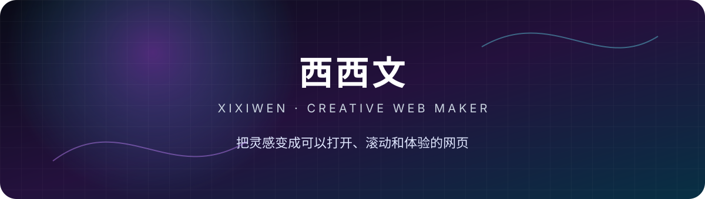

  

  <a href="https://github.com/xxwxixiwen?tab=repositories">作品</a>
  &nbsp;·&nbsp;
  <a href="https://xxwxixiwen.github.io/personal-website/">个人网站</a>
  &nbsp;·&nbsp;
  <a href="https://github.com/xxwxixiwen">GitHub</a>

## 👋 关于我

你好，我是 **西西文（Xixiwen）**。

我正在用代码和 AI 制作有视觉表现力的网页体验，关注交互设计、创意前端和浏览器中的图像实验。喜欢把一个想法从草图推进成真正可以打开、滚动和体验的作品。

- 🎨 正在探索创意网页、3D 动效与交互叙事
- 🧪 喜欢把视觉概念做成可运行的前端原型
- 🌱 持续学习 TypeScript、React、WebGL 和 AI 辅助创作
- 🖼️ 关注图像体验、响应式设计与无障碍交互

## ✨ 精选作品

### [美图秀秀 · 暗夜影像实验室](https://github.com/xxwxixiwen/meitu-after-dark)

一个非官方概念宣传网站。通过滚动 3D 空间、WebGL 影像、动态标题和本地图片实验室，探索影像产品的沉浸式网页表达。

`TypeScript` · `React` · `Vite` · `WebGL` · `CSS 3D` · `GitHub Pages`

- 本地完成滤镜、亮度、对比度和饱和度处理
- 支持原图对比、贴纸操作与 PNG 导出
- 包含键盘操作、响应式布局和减少动态效果支持

### [个人网站](https://github.com/xxwxixiwen/personal-website)

使用原生 HTML、CSS 和 JavaScript 搭建的现代简约个人网站，包含自我介绍、技能、作品集和联系方式等板块。

`HTML` · `CSS` · `JavaScript` · `GitHub Pages`

🌐 [在线访问](https://xxwxixiwen.github.io/personal-website/)

## 🧰 技术与工具

  
  
  
  
  
  
  

## 📊 GitHub 数据

  
  

  把灵感做成看得见、用得上的作品。

